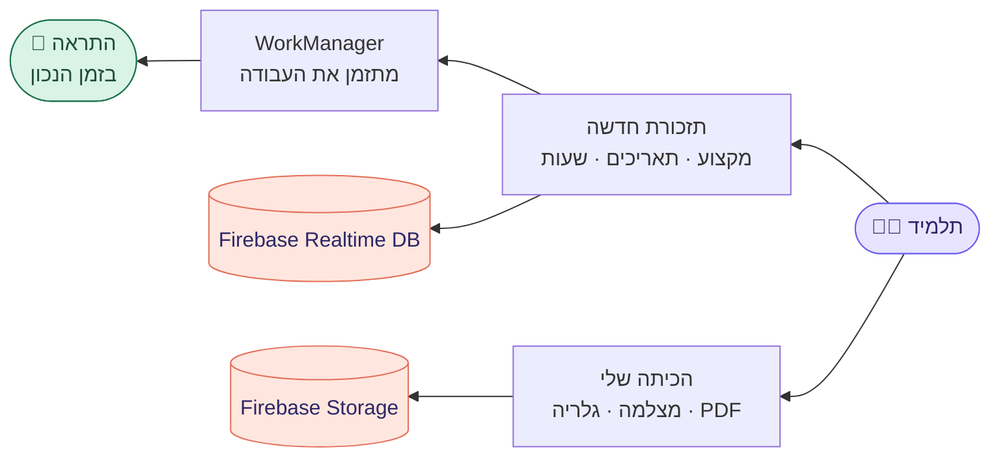
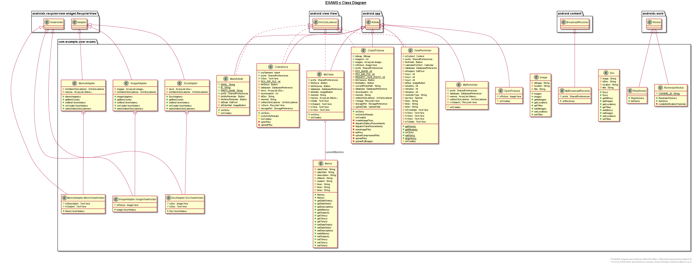

  

  
  
  

<h3 align="center">תזכורות, חומרי לימוד וניהול זמן לסטודנטים, באפליקציה אחת.</h3>

  

  אפליקציית אנדרואיד שנבנתה כפרויקט גמר של 5 יחידות במדעי המחשב: תזכורות לימוד חכמות, מרחב עבודה לכל מקצוע, ותמונות ומסמכים שמסונכרנים לענן.

<table align="center">
  <tr>
    <td align="center" width="25%"><a href="#highlights"><b>⏰ חכמות</b></a> תזכורות לימוד</td>
    <td align="center" width="25%"><a href="#highlights"><b>📚 1</b></a> מרחב לכל מקצוע</td>
    <td align="center" width="25%"><a href="#tech-stack"><b>☁️ Firebase</b></a> מסד נתונים ואחסון</td>
    <td align="center" width="25%"><a href="HaMivchanon.pdf"><b>📐 UML</b></a> תיק תכנון מלא</td>
  </tr>
</table>

<table>
  <tr valign="top">
    <td width="33%">
<b>⏰ תזכורות לימוד חכמות</b>
<ul><li><b>התראות מקומיות</b> עם <code>WorkManager</code> ו־<code>BroadcastReceiver</code></li><li><b>טווח תאריכים ושעות</b> שהתלמיד בוחר</li><li><b>שעונים מונפשים</b> עם Lottie</li></ul></td>
    <td width="33%">
<b>📚 הכיתה שלי</b>
<ul><li><b>מרחב לכל מקצוע</b> עם כל החומרים שלו</li><li><b>מצלמה, גלריה או PDF</b> ישר מהמכשיר</li><li><b>תמונות עם זום</b> לקריאת סיכומים</li></ul></td>
    <td width="33%">
<b>☁️ מסונכרן לענן</b>
<ul><li><b>Firebase Realtime Database</b> לתזכורות ולפתקים</li><li><b>Firebase Storage</b> לתמונות ולמסמכים</li><li><b>כניסה פשוטה</b> עם מייל, שנשמר ב־<code>SharedPreferences</code></li></ul></td>
  </tr>
</table>

 תרשים המחלקות: מסכים, מתאמים, מודלים ו־Workers (המקור ב־<a href="app.plantuml"><code>app.plantuml</code></a>)

ב[תיק הפרויקט](HaMivchanon.pdf) יש את כל התכנון: תרשימי Use Case ורצף, תרשימי מחלקות UML, מבנה מסד הנתונים עם מודלים של JSON ותכנון מלמעלה למטה.

  
  
  
  
  
  

1. משכפלים את הריפו ופותחים את התיקייה ב־**Android Studio**.
2. מחכים ש־Gradle יסתנכרן ([`build.gradle`](build.gradle)).
3. מוסיפים `google-services.json` מפרויקט Firebase משלכם (עם Realtime Database ו־Storage).
4. מריצים על מכשיר או אמולטור עם אנדרואיד 8.1 (API 27) ומעלה.

  
  
  
  

