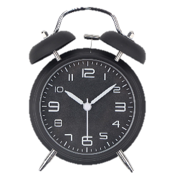
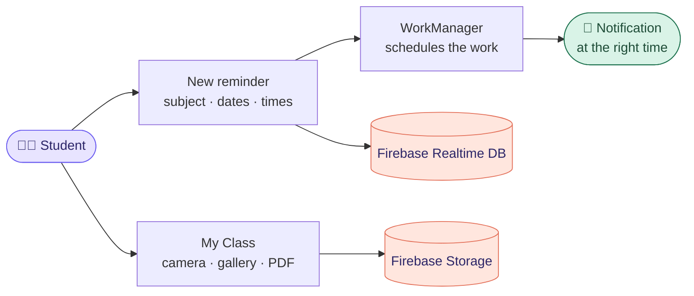
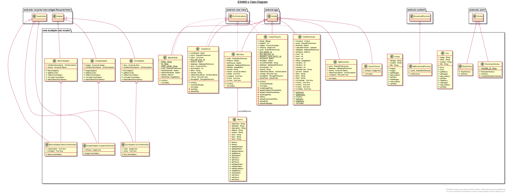

  

  
  
  

<h3 align="center">Reminders, materials and time management for students, in one app.</h3>

  

  A native Android app built as a 5-unit Computer Science final project: smart study reminders, a workspace for every subject, and photos and documents synced to the cloud.

<table align="center">
  <tr>
    <td align="center" width="25%"><a href="#highlights"><b>⏰ Smart</b></a> study reminders</td>
    <td align="center" width="25%"><a href="#highlights"><b>📚 1</b></a> workspace per subject</td>
    <td align="center" width="25%"><a href="#tech-stack"><b>☁️ Firebase</b></a> database + storage</td>
    <td align="center" width="25%"><a href="HaMivchanon.pdf"><b>📐 UML</b></a> full design portfolio</td>
  </tr>
</table>

<table>
  <tr valign="top">
    <td width="33%">
<b>⏰ Smart study reminders</b>
<ul><li><b>Local notifications</b> with <code>WorkManager</code> and <code>BroadcastReceiver</code></li><li><b>Date ranges and set times</b> chosen by the student</li><li><b>Animated clocks</b> with Lottie</li></ul></td>
    <td width="33%">
<b>📚 My Class workspace</b>
<ul><li><b>One area per subject</b> for all its materials</li><li><b>Camera, gallery or PDF</b> straight from the device</li><li><b>Zoomable images</b> for reading notes</li></ul></td>
    <td width="33%">
<b>☁️ Synced to the cloud</b>
<ul><li><b>Firebase Realtime Database</b> for reminders and notes</li><li><b>Firebase Storage</b> for photos and documents</li><li><b>Simple sign-in</b> by email, kept in <code>SharedPreferences</code></li></ul></td>
  </tr>
</table>

 Class diagram: activities, adapters, models and workers (source in <a href="app.plantuml"><code>app.plantuml</code></a>)

The [project portfolio](HaMivchanon.pdf) has the full design: use case and sequence diagrams, UML class diagrams, the database structure with JSON models, and a top-down design.

  
  
  
  
  
  

1. Clone the repository and open the folder in **Android Studio**.
2. Let Gradle sync ([`build.gradle`](build.gradle)).
3. Add your own `google-services.json` from a Firebase project (Realtime Database and Storage turned on).
4. Run on a device or emulator with Android 8.1 (API 27) or newer.

  
  
  
  

